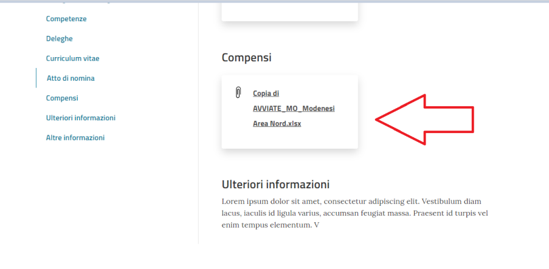
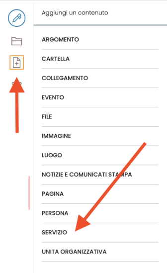
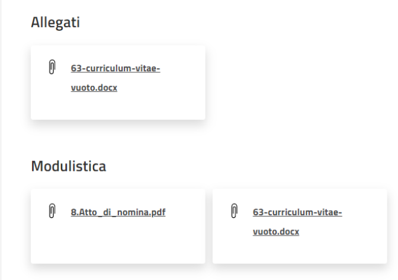

# Content-type “Servizio”

Tipologia che descrive i servizi sanitari e le prestazioni sanitarie di una ASL

I campi del servizio sono (in giallo i campi obbligatori):

**Elemento** **Descrizione**

|Titolo del servizio|Nome del Servizio. In interfaccia, questo elemento apparirà nella Hero della pagina.|
|---|---|
|**Stato del servizio**|Indicare se il servizio è attivo o non attivo. In interfaccia, questo elemento apparirà nella Hero della pagina.|
|**Sottotitolo**|Eventuale sottotitolo del Servizio, oppure un nome che identifica informalmente il Servizio. Si differenzia dalla descrizione breve perché aggiunge ulteriori informazioni identificative (come ad esempio un altro nome che può essere usato), ma non basta per descriverlo e far capire di cosa si tratta a un utente che non ne ha mai sentito parlare. In interfaccia, questo elemento apparirà nella Hero della pagina.|
|**Descrizione breve**|Descrizione sintetica, con un linguaggio semplice, che possa aiutare qualsiasi utente a identificare con chiarezza di che tipo di servizio o prestazione si tratta e il contenuto di pagina. Non utilizzare un linguaggio ricco di riferimenti normativi, amministrativi o scientifici. In interfaccia, questo elemento apparirà nella Hero della pagina.|
|**Prenota online**|Call to action all'eventuale funzionalità di prenotazione online del servizio o della prestazione. Il pulsante "Prenota online" è elemento necessario se la funzione di prenotazione online è disponibile. In interfaccia, questo elemento apparirà nella Hero della pagina.|
|**Immagine**|Immagine che rappresenta il servizio. In interfaccia, questo elemento apparirà nella Hero della pagina.|
|**Cosa serve**|Elenco delle cose necessarie per attivare e poter usufruire del servizio o della prestazione (documenti necessari, o altro) con le relative istruzioni all'uso e eventuale collegamento a una pagina Come fare per.|
|**Accedi al servizio**|Le indicazioni per accedere al servizio o alla prestazione. Ad esempio "Presentati in sede durante gli orari di apertura, oppure "Prenota direttamente online usando la prescrizione del medico o telefona il CUP allo +39 00 000 000". Se è disponibile la prenotazione online, inserire un pulsante "Prenota online" con il link al flusso di prenotazione.|

|Tempi di attesa|Indicazioni sulle tempistiche necessarie per usufruire del servizio o della prestazione secondo urgenze e organizzazione delle strutture.|
|---|---|
|**Costi**|Condizioni e termini economici per usufruire del servizio o della prestazione. Se il servizio non ha un costo specifico, indicare i costi del ticket sanitario. Se il servizio è gratuito, specificare "Il servizio è gratuito".|
|**Dove**|Indicazione della struttura o delle strutture dove viene erogato il servizio o la prestazione. Includere il nome della struttura e l'indirizzo, con il collegamento alla pagina foglia struttura di riferimento.|
|**Orari del servizio**|Indicazione dell'orario in cui è possibile usufruire del servizio o della prestazione. Se gli orari del servizio coincidono con quelli della struttura che lo eroga, ripeterli anche sulla pagina del servizio.|
|**Contatti**|I contatti per il servizio come telefono e email. Se non esistono contatti specifici per il servizio o la prestazione, si possono mettere i contatti dell'URP, del CUP, dell'unità organizzativa o della struttura che eroga il servizio.|
|**Cos'è**|Descrizione estesa e completa del servizio o della prestazione. Se si sta descrivendo un Percorso di Cura specificare contestualmente l'elenco delle prestazioni afferenti al percorso.|
|**A chi è rivolto**|Descrizione testuale degli utenti dell'ASL a cui è rivolto il servizio o la prestazione. Se utile, aggiungere l'indicazione delle voci della Tassonomia Utenti associabili a questo servizio. Non usare i tag Utenti se il servizio è rivolto a tutti gli utenti dell'ASL.|
|**Procedure collegate all'esito**|Spiegazione relativa all'esito della procedura e dove eventualmente sarà disponibile o sarà possibile ritirare l'esito (sede dell'ufficio, orari, numero sportello, etc.)|
|**Unità organizzativa** **responsabile**|Indicazione del Dipartimento o dell'Unità Operativa responsabile dell'erogazione di questo servizio, con collegamento alla relativa pagina foglia unità organizzativa.|
|**Responsabile del servizio**|Eventuale responsabile del servizio o della prestazione, con collegamento alla relativa pagina foglia persona.|
|**Documenti**|Lista di eventuali documenti collegati al servizio, con collegamento alle relative pagine foglia.|

|Servizi e prestazioni correlati|Lista dei servizi e delle prestazioni simili o in qualche modo collegati a quello di cui si vuole usufruire, con collegamento alle relative pagine foglia.|
|---|---|
|**Avvisi e notizie**|Lista degli avvisi o notizie che possono riguardare il servizio descritto, con collegamento alle pagine foglia di riferimento.|
|**Ulteriori informazioni**|Eventuali ulteriori dati e informazioni utili alla fruzione del servizio o della prestazione descritto. Rientrano in questo elemento tutte le informazioni non inserite nei campi precedenti ma che aiutano a chiarire come si svolge il percorso di erogazione e fruzione del servizio.|
|**Parliamo di**  |Indicazione degli argomenti con cui il contenuto di pagina è stato taggato. Al click, l'utente atterra sulla relvativa Pagina aggregatrice Argomento.[^n10]|

La creazione di un Servizio predispone automaticamente due contenitori pagina:

- Modulistica
- Allegati che possono essere popolati dalla folder_contents attraverso l’upload di file.

Esse possono essere caricate con modulistica (file) e altri allegati da scaricare

[^n10]: Si veda la sezione di ricerca dedicata

:::{warning}
**Attenzione!** Non si devono modificare i nomi delle cartelle all’interno del servizio.
:::
