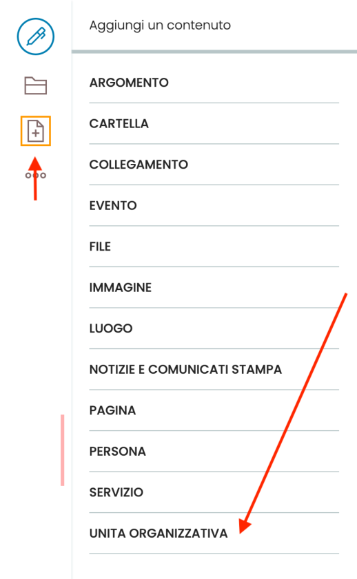
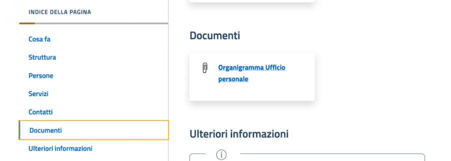

# Content-type “Unità organizzativa”

Questa Tipologia descrive un'unità organizzativa dell'ASL in base alla struttura interna, come Dipartimenti, Distretti, Direzioni, Uffici, Unità operative (UOC).

Oltre al titolo e descrizione, gli altri campi del content-type sono (in giallo i campi obbligatori):

**Elemento** **Descrizione**

|Nome dell'unità organizzativa|Titolo della struttura. In interfaccia, questo elemento apparirà nella Hero della pagina.|
|---|---|
|**Sottotitolo**|Eventuale sottotitolo dell'unità organizzativa, ad esempio un nome che la identifica informalmente o la specifica di una specializzazione. Si differenzia dalla descrizione breve perché aggiunge ulteriori informazioni identificative, ma non basta per descriverla e far capire di cosa si tratta a un utente che non ne ha mai sentito parlare. In interfaccia, questo elemento apparirà nella Hero della pagina.|
|**Descrizione breve**|Descrizione sintetica, con un linguaggio semplice, che possa aiutare qualsiasi utente a identificare con chiarezza di che tipo di struttura si tratta e il contenuto di pagina. Non utilizzare un linguaggio ricco di riferimenti normativi, amministrativi o scientifici. In interfaccia, questo elemento apparirà nella Hero della pagina.|
|**Immagine**|Immagine principale e rappresentativa dell'unità organizzativa. In interfaccia, questo elemento apparirà nella Hero della pagina.|
|**Competenze**|Elenco/descrizione dei compiti assegnati alla struttura.|
|**Dove**|Indirizzo della sede amministrativa di rappresentanza aperta al pubblico dell'unità organizzativa. Specificare la via con il numero civico, il CAP e la città. Se disponibili, specificare anche quartiere o circoscrizione. Includere un link "Apri in mappa" per portare gli utenti a visualizzare la posizione della sede su un servizio terzo di locazione. Se la sede coincide con una struttura dell'ASL, includere collegamento alla relativa pagina foglia struttura.|
|**Orari di apertura**|Indicazione delle fasce orarie in cui è possibile contattare o accedere all'unità organizzativa|
|**Contatti**|I contatti dell'unità organizzativa, come telefono ed email.|

|Fa parte di|Indicare l'unità organizzativa genitore di cui fa parte (ad esempio, uno specifico dipartimento), con collegamento alla relativa pagina foglia. Questo elemento è necessario quando l'unità organizzativa della pagina fa parte di un'unità genitore.|
|---|---|
|**Responsabile dell'unità** **organizzativa**|Indicazione della persona che è responsabile dell'unità organizzativa, con collegamento alla relativa pagina foglia persona. L'etichetta cambierà a seconda del tipo di unità organizzativa (ad esempio, se è la pagina di un Dipartimento, l'etichetta sarà “Responsabile del dipartimento”.|
|**Servizi**|L'elenco dei servizi sanitari e delle prestazioni sanitarie al pubblico gestiti dall'unità organizzativa, con collegamento alle relative pagine foglia servizio.|
|**Strutture**|L'elenco delle strutture dell'ASL che fanno capo all'unità organizzativa, con collegamento alle relative pagine foglia struttura.|
|**Personale**|L'elenco delle persone che lavorano nell'unità organizzativa, con collegamento alle relative pagine foglia persona.|
|**Documenti**|Elenco dei documenti correlati, con collegamento alle relative pagine foglia documento (se documenti ufficiali dell'ASL) o download diretto degli allegati|
|**Avvisi e notizie**|Elenco degli avvisi e delle notizie più recenti che riguardano l'unità organizzativa, con collegamento alle relative pagine foglia notizia o comunicato.|
|**Ulteriori informazioni**  |Ulteriori informazioni sull'unità organizzativa non contemplate dai campi precedenti.|

L’Unità organizzativa si utilizza per creare ad esempio gli Uffici dell’organizzazione. La creazione di una Unità organizzativa crea in automatico una pagina contenitore “Documenti” che può essere popolata allegando file dalla modalità folder_content, la quale popola l’apposita sezione Documenti in visualizzazione dell’Unità organizzativa stessa.

:::{warning}
**Attenzione!** Non si devono modificare i nomi delle cartelle all’interno dell’unità organizzativa.
:::

Come per altri tipi di contenuto, nell’Unità Organizzativa c'è la possibilità di inserire altri campi interessanti quali **Via, CAP, Città, Nazione**, che permettono attraverso un apposito plugin per ricercare e geolocalizzare la UO su una mappa.
