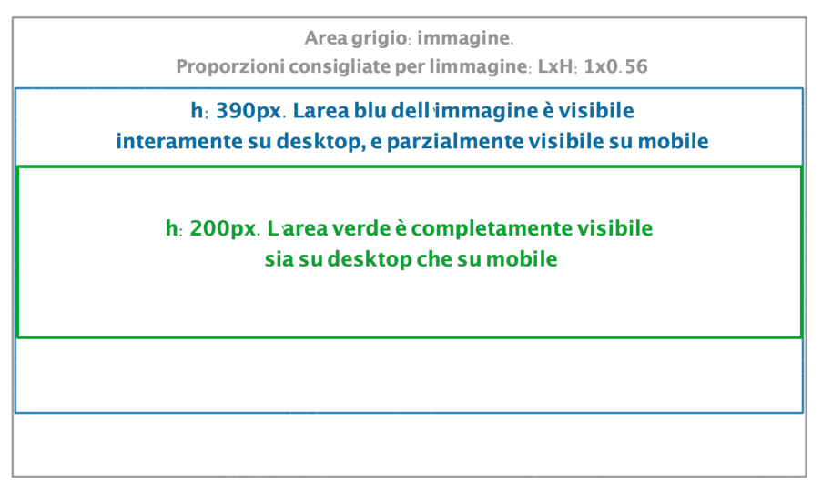
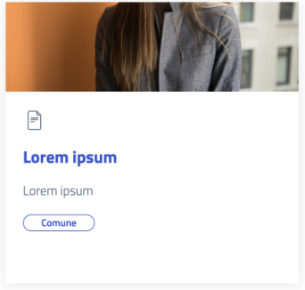
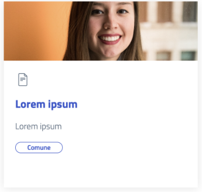

# Dimensioni dell’immagine di anteprima

All’interno dei Content-type è possibile impostare un’immagine di anteprima che verrà mostrata all’interno di diversi blocchi nel momento in cui viene elencato il CT stesso. In assenza di un’immagine di anteprima, verrà mostrata l’immagine di testata. La possibilità di impostare un’immagine di anteprima è utile in quanto permette di inserire un’immagine nel formato ideale per il tipo di blocco che verrà poi utilizzato in altre pagine. In base al tipo di blocco in cui si vuole mostrare il content-type, dunque, è consigliabile utilizzare immagini nei seguenti formati:

## Blocco Elenco - Card con immagine

**Opzione default (senza attivare checkbox non alterare le dimensioni naturali dell’immagine)** Proporzione: 1:0,5625 (cioè 16:9) Dimensioni minime consigliate: 700 x 395 pixel Orientamento: Orizzontale

**Opzione “non alterare le dimensioni naturali dell’immagine”** Minimo 700 pixel in larghezza

## Blocco Elenco - Card in evidenza

Proporzione: 1:0,60 Dimensioni minime consigliate: 700 x 420 pixel Orientamento: Orizzontale

**N.B** . Viene mostrata solo l’immagine del primo CT nell’ordine selezionato **N.B.** Nel caso in cui la card cambi dimensioni per accomodare testi più lunghi lo spazio allocato all'immagine cambia. In tal caso la card si espande in altezza, ma non potendo espandersi in larghezza, cambierà la dimensione dello spazio dedicato all'immagine, che quindi cambierà proporzione. Se si desidera mantenere le proporzioni dell’immagine, assicurarsi di non inserire titoli o descrizioni troppo lunghe nel contenuto per non variare le proporzioni della card.

## Blocco Elenco - Card con testo animato

Proporzione: 1:1 Dimensione minima consigliata: 400 x 400 pixel Orientamento: Nessuno (quadrato)

## Blocco Elenco - Contenuto in evidenza

Proporzione: viene mantenuta la proporzione dell’immagine Dimensione minima consigliata: 700 pixel in larghezza Orientamento: Originale

## Blocco Elenco - Quadratoni con immagine

**Opzione 1** Proporzione: 1:1 Dimensione minima consigliata: 400 x 400 pixel Orientamento: Nessuno (quadrato)

## Blocco Elenco - Photogallery

**1 foto per pagina** Proporzione: 1:0,3 Dimensione minima consigliata: 2050 x 600 pixel Orientamento: Orizzontale

**2 foto per pagina** Proporzione: 1:0,6 Dimensione minima consigliata: 1026 x 600 pixel Orientamento: Orizzontale

**3 foto per pagina** Proporzione: 1:0,87 Dimensione minima consigliata: 684 x 600 pixel Orientamento: Orizzontale

## Blocco Elenco - Slider

**Slide singola** Proporzione: 1:0,36 Dimensione minima consigliata: 2160 x 800 pixel Orientamento: Orizzontale

**Slide doppia (affiancata)** Proporzione: 1:0,50 Dimensione minima consigliata: 1200 x 600 pixel Orientamento: Orizzontale

**3 Slide** Proporzione: 1:0,9 Dimensione minima consigliata: 672 x 600 pixel Orientamento: Orizzontale

## Blocco Elenco - Link solo immagini

Proporzione: 1:0,6 Dimensione minima consigliata: 280 x 160 pixel Orientamento: Orizzontale

## Blocco Contenuto in evidenza

Proporzione: 1:0,6 Dimensione minima consigliata: 1200 x 800 pixel Orientamento: Orizzontale

Tutte le dimensioni qui elencate sono suggerimenti per una visualizzazione immagini il più ottimale possibile. Immagini che non rispettano queste dimensioni verranno adattate e potrebbero risultare sgranate se non abbastanza grandi o di buona risoluzione. Inoltre, immagini che non rispettano le indicazioni e l’orientamento indicati, verranno allineate centralmente sull’asse verticale, rendendo dunque visibile solo la parte centrale dell’immagine. Per questo motivo, se non si dispone di un’immagine di risoluzione abbastanza elevata, **è** **consigliabile** utilizzare un’immagine con il focus principale nella parte centrale.

Esempio:

→

→

