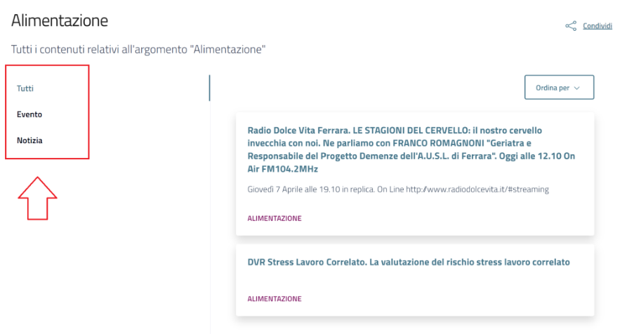

# Pagine di ricerca per argomenti del modello AgID

Su alcuni tipi di contenuti è previsto un campo “Parliamo di”, che consente di selezionare da una lista di valori predefiniti dal modello gli “Argomenti” di riferimento.

La selezione si traduce nella creazione di opportune chips visibili sul dettaglio del contenuto.

Tali chips sono cliccabili, e rimandano alla sezione di ricerca filtrata per quell’argomento.

Nella parte sinistra viene mostrato l’indice dei tipi di contenuto che sono stati categorizzati con quell’argomento (e. “alimentazione”): al click della voce dell’indice l’elenco dei risultati viene filtrato.

