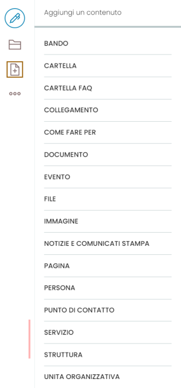

# Tipi di contenuto specializzati per AgID

Oltre ai tipi di contenuto standard che fanno nativamente parte del CMS, per il suo funzionamento, esiste una serie di content-type “ad-hoc” realizzati appositamente, su indicazione di AgID, per

realizzare l’impianto generale e rispettare il modello di contenuti e l’architettura informativa raccomandata da AgID stessa.

I riferimenti alla documentazione ufficiale [https://designers.italia.it/modelli/aziende-sanitarie-locali/](https://designers.italia.it/modelli/aziende-sanitarie-locali/) [https://designers.italia.it/files/resources/modelli/aziende-sanitarie-locali/Alberatura-ModelloASL-DesignersItalia.pdf](https://designers.italia.it/files/resources/modelli/aziende-sanitarie-locali/Alberatura-ModelloASL-DesignersItalia.pdf)
