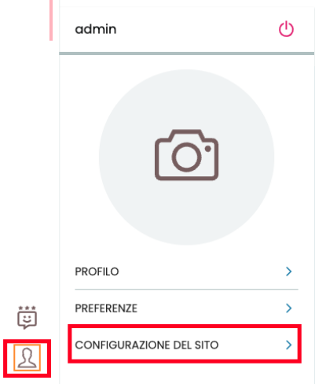

# Menu di configurazione del sito

Dal menu di configurazione del sito si possono gestire varie configurazioni tra cui:

- Il menù
- Il menù secondario in testata
- Il configuratore footer
- Alcune voci aggiuntive nel footer
- Il configuratore subfooter
- La configurazione dei blocchi di ricerca
- La configurazione dei vocabolari
- Il configuratore dei social

Per maggiori dettagli vedere le sezioni successive.

Al menu di configurazione del sito si accede lato amministrazione tramite utente loggato con diritti da amministratore. Cliccando sull'icona supplementare della barra operativa e su “configurazione del sito”

Si accede quindi al menu di configurazione del sito (per la sola parte di competenza degli amministratori - sezione “ **Configurazione prodotti aggiuntivi** ”:
