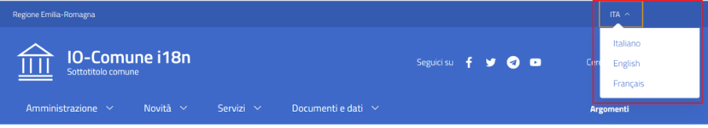
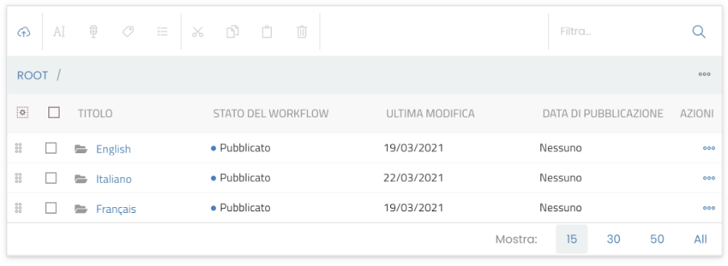
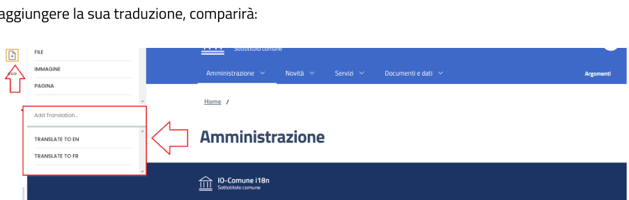
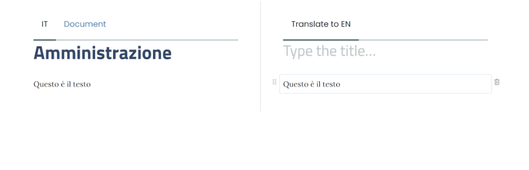
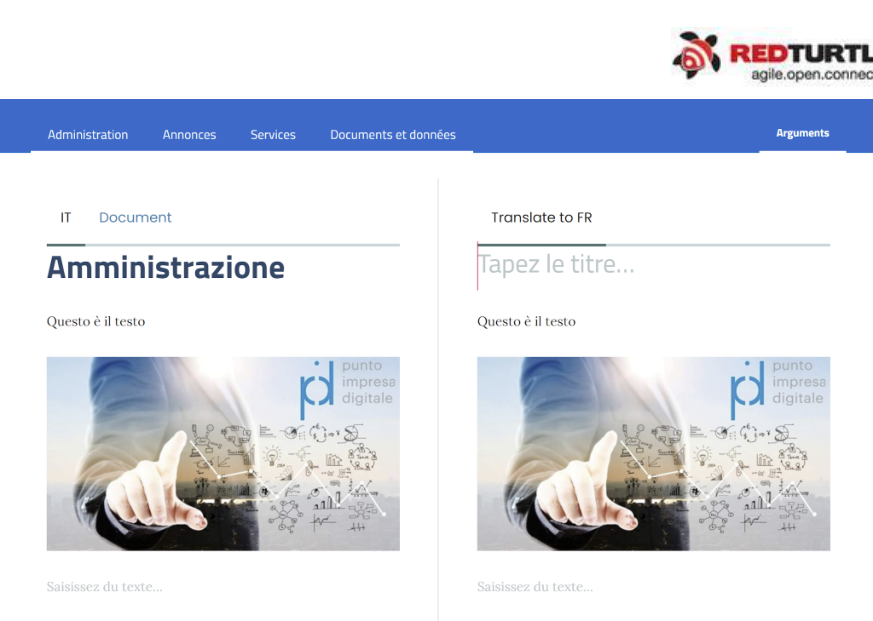
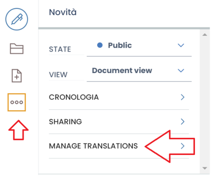
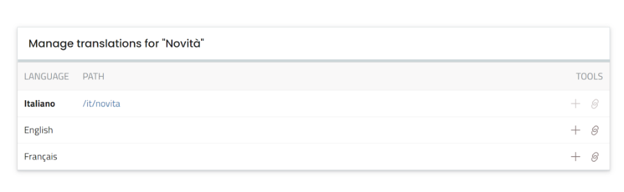
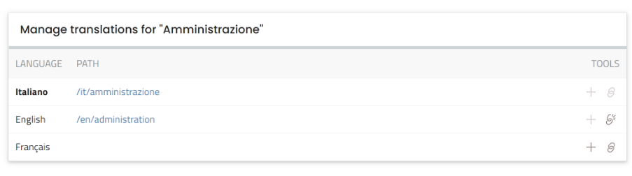
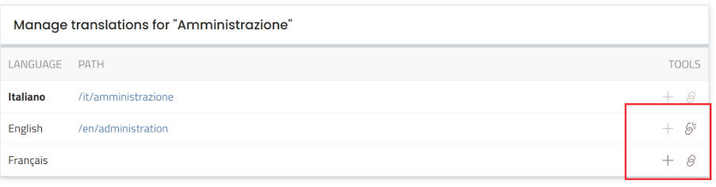

# Multilinguismo

Nel caso in cui il portale sia configurato per essere multilingua, il sistema fondamentalmente mostrerà un selettore di lingua nella barra in alto, per switchare rapidamente da un contenuto alla sua traduzione nella lingua corrispondente.

In generale, la versione in italiano del sito sarà rappresentata dalla URL **https://\<sito>/it**, quella in inglese dalla URL **https://\<sito>/en**, ecc..

Dal punto di vista del piano editoriale, il multilinguismo si traduce nella presenza in una cartella **root** di sistema, all’interno della quale sono presenti tante cartelle quante sono le lingue

Dentro a ciascuna cartella di ogni lingua, viene creata automaticamente una cartella di sistema ( **non modificare, nè cancellare** ) che si chiama:

- **Assets** : per la lingua inglese
- **Risorse:** per la lingua italiana
- **Ressource de base:** per la lingua francese e così via. Quelle cartelle sono utili perché possono contenere risorse che vengono condivise indipendentemente dalla lingua (ad esempio, immagini condivise)

**NOTA IMPORTANTE:** nel costruire le traduzioni di un sito è sempre bene procedere gradualmente, ovvero:

- Nel caso di presenza di contenitori/pagine di disambiguazione, è sempre opportuno procedere prima con la traduzione di queste, poi con la traduzione degli elementi contenuti, per mantenere coerenza nella struttura dell'albero del sito
- viceversa, nel caso in cui si proceda a tradurre prima le “foglie” (ovvero elementi che sono contenuti in un contenitore), la loro traduzione verrà automaticamente messa sotto la root del sito, e questo creerebbe un disaccoppiamento dell'alberatura (comunque, gestibile in un secondo momento attraverso lo spostamento, ma comunque più difficoltoso)

Ogni contenuto, indipendentemente dalla lingua in cui si sta lavorando, può essere tradotto in una delle altre lingue impostate, sempre che il contenuto non sia già stato tradotto. Operativamente, nel momento in cui si lavora su un qualche tipo di contenuto (qualunque esso sia), nella barra degli strumenti di sinistra sarà possibile aggiungere le sue traduzioni in due modalità differenti:

1.  Cliccando sul pulsante 

2.  Cliccando sul pulsante 
Nel primo caso, supponendo di essere sulla pagina “amministrazione” in italiano, e volendo

aggiungere la sua traduzione, comparirà:

In questo caso, non essendo la risorsa “Amministrazione” già stata tradotta, il sistema propone entrambe le possibili lingue, perchè nessuna delle due ha una traduzione. Supponendo di tradurre in inglese ( **Translate to EN** ), verrà aperto un apposito pannello in cui:

- nella parte sinistra viene mostrata la risorsa originale da tradurre (in questo caso, la versione italiana)
- nella parte destra, tutti i campi corrispondenti a quelli in italiano, vuoti, pronti a ricevere la traduzione

Sul salvataggio, le due pagine vengono automaticamente collegate tra loro, in modo tale che, quando ci si trova su una risorsa tradotta, se si fa lo switch del selettore della lingua, verrà mostrata la corrispondente versione tradotta. Il pannello di traduzione riporterà tutti gli elementi presenti nella pagina di partenza, compresi eventuali blocchi (immagine, elenco, testo, video ecc)

Nel secondo caso, cliccando quindi sul pulsante , verrà presentata una schermata che

mostra il pannello e successivamente l’elenco delle lingue disponibili

Questo pannello indica che la risorsa nella lingua “ **Italiano** ” è presente nel percorso **/it/novita,** mentre le corrispondenti traduzioni nelle lingue Inglese e Francese non sono presenti. Qualora fosse già presente una traduzione, ne verrà mostrato il percorso

In questo caso, per la risorsa “Amministrazione”, è già presente la corrispondente traduzione in lingua inglese.

I pulsanti a destra di ciascuna risorsa nella rispettiva lingua

danno la possibilità di:

- aggiungere la traduzione (è l’equivalente del pulsante “Translate to XX” del punto precedente, ovvero il pulsante **‘+’** )
- Collegare direttamente la risorsa, nel caso sia stata aggiunta dalla folder_contents con gli strumenti classici di inserimento di un nuovo contenuto (senza passare quindi dallo strumento di traduzione diretto). In questo caso, verrà presentata una sidebar nella parte destra, che permetterà di scorrere l’albero di navigazione del sito per ricercare e collegare la risorsa desiderata

