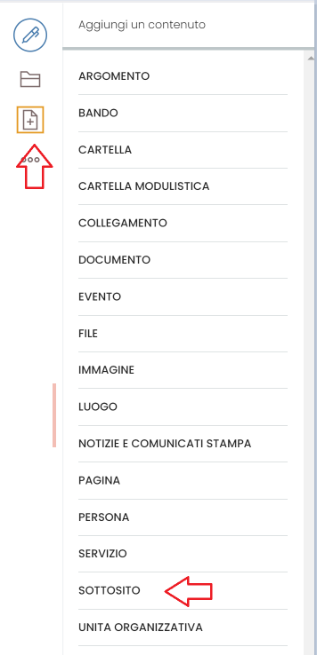
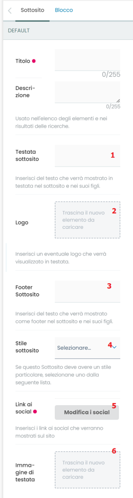
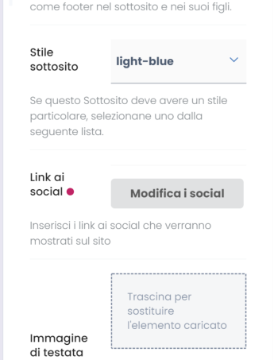
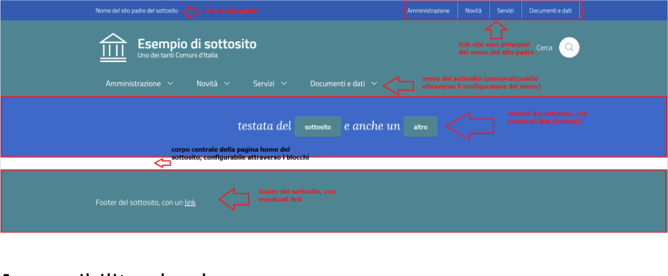

# Sottositi

I sottositi consentono di gestire una cartella del piano editoriale come se fosse a tutti gli effetti un sito a se stante, con grafica dedicata e menù personalizzato[^n14].

Dal momento in cui si definisce una cartella sottosito, ogni sottocartella erediterà automaticamente lo stile del sottosito, dal punto di vista della caratterizzazione grafica. Un sottosito è a tutti gli effetti un tipo di contenuto specializzato, che si aggiunge attraverso la barra degli strumenti

Le principali caratteristiche di un sottosito sono (si veda immagine seguente):

- E’ una pagina a blocchi, per gestire la Homepage del sottosito
- Ripropone automaticamente nella barra sopra la testata il link al sito padre, e i riferimenti alle sue voci di menu di primo livello
- Ha una “sottotestata” personalizzabile, per caratterizzare la homepage, sia come immagine che come testo (1) (4) - è un richtext per permettere di inserire link o bottoni
- Ha un “pre-footer” personalizzabile (2) che verrà mostrato in tutto il sottosito - il footer è personalizzabile soltanto con del testo formattabile, per inserire eventuali link (richtext)
- Impostare il colore primario e secondario del sottosito, selezionabile da un set di colori preimpostati (3)[^n15]

[^n14]: Si veda la sezione Menu configurabile

[^n15]: Non si ha massima libertà nella scelta del colore, ma si deve scegliere da colori preimpostati, per ottemperare alle esigenze di accessibilità dettate dalle linee guida AgID (accessibilità dei colori)

Vediamo nel dettaglio le caratteristiche di ciascun campo:

- **Titolo del sottosito:** è il titolo del sottosito stesso
- **(1) Testata sottosito**
  - E’ un campo richtext (ovvero formattabile attraverso l’apposita barra di formattazione). Qualsiasi link che viene inserito in questo campo viene automaticamente trasformato in un bottone che manda al link specificato
  - Diventa un header che sta immediatamente sotto alla testata principale del sito in homepage

  - Se viene impostato il campo **Immagine in testata (4)**, automaticamente l’immagine diventa lo sfondo della testata sottosito (si consiglia di inserire una immagine trasparente con proporzioni 1:0.23 di almeno 1900px di larghezza. In ogni caso, la dimensione della fascia dipenderà dal contenuto.)
- **(2) Logo sottosito:** consente di definire un logo personalizzato al sito tematico
- **(3) Footer sottosito**
  - E’ un campo richtext (ovvero formattabile attraverso l’apposita barra di formattazione). Eventuali link inseriti vengono mostrati come link semplici alla risorsa collegata. Il colore di sfondo del Footer è il colore primario scelto per il sottosito. Il footer del sottosito verrà mostrato in tutte le pagine del sottosito, prima del footer del sito padre.
- **(4) Stile sottosito**
  - E’ uno stile selezionabile da una lista di stili pre-impostati. Gli stili disponibili come colore primario e colore secondario sono i seguenti:

    - **Light-blue**
    - **Yellow**
    - **…**
- **(5) Link ai social**
- **(6) Immagine in testata**
  - Costituisce l’eventuale immagine di sfondo da applicare alla testata del sottosito
  - L’immagine deve avere le caratteristiche indicate al punto (1)

E’ possibile definire anche i social destinati ai singoli sottositi **(5)** :

Una volta salvato il sottosito si ottiene:

