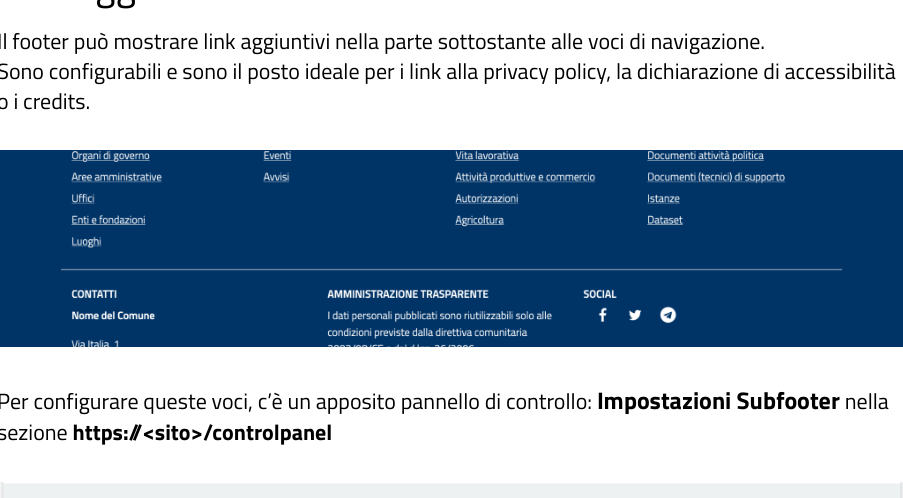
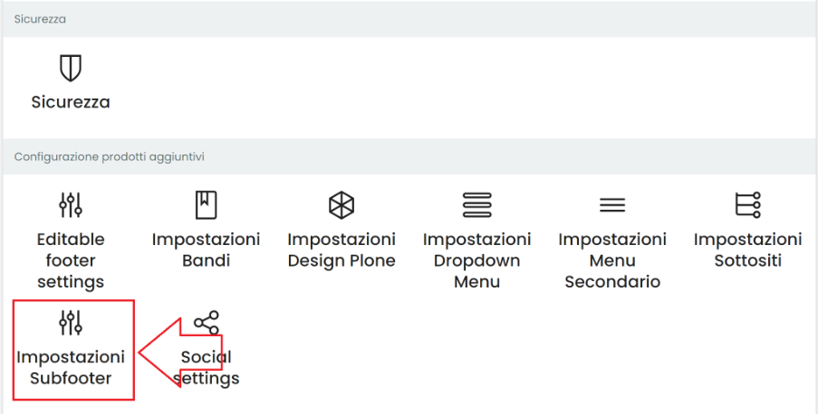
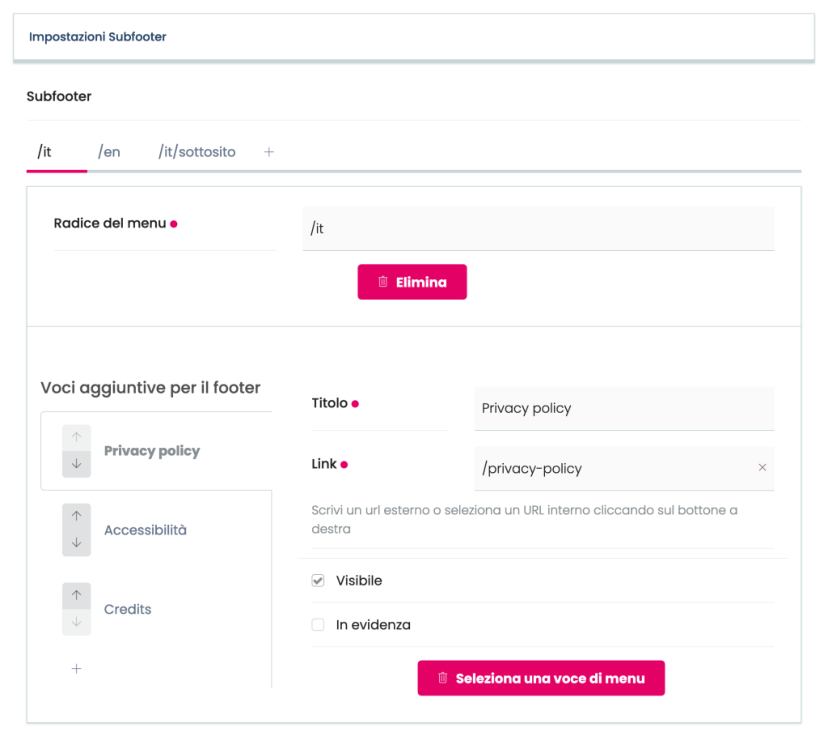

# Voci aggiuntive nel footer

Il footer può mostrare link aggiuntivi nella parte sottostante alle voci di navigazione. Sono configurabili e sono il posto ideale per i link alla privacy policy, la dichiarazione di accessibilità o i credits. Per configurare queste voci, c’è un apposito pannello di controllo: Impostazioni Subfooter nella sezione https://\<sito>/controlpanel

Questo pannello di controllo funziona esattamente come quello del menu secondario, per cui replicheremo qui solo uno screenshot e rimandiamo al suddetto capitolo per spiegazioni. NOTA: anche qui prestare attenzione alla gestione dei sottositi.

