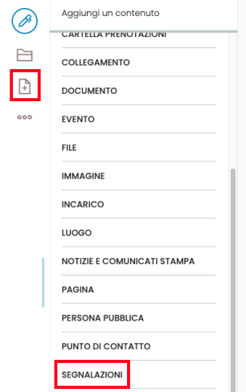
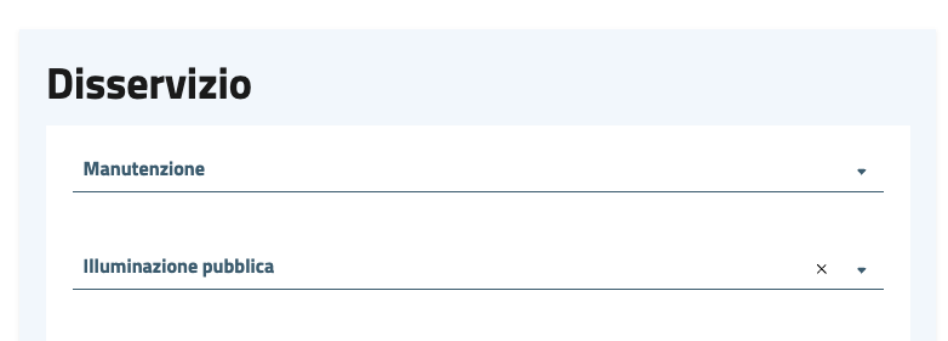

# Manuale admin (creazione oggetto Segnalazioni)

## Content-type “Segnalazioni”

Essendo l’oggetto Segnalazioni la rappresentazione digitale di servizio, è di fatto un tipo di contenuto del CMS aggiungibile tramite il menù.

Il CT Segnalazioni consiste nei seguenti campi:

### [Tab Default]

- **Titolo** : nome del modulo di segnalazione, solitamente “Segnalazione disservizio”.
- **Descrizione** : descrizione sintetica del contenuto.
- **Testo Privacy** : titolo o testo introduttivo relativo all’informativa privacy mostrata all’utente nella fase iniziale del processo.
- **Testo Casella Privacy** : testo mostrato accanto alla casella di accettazione privacy, che l’utente deve leggere e selezionare per procedere.
- **Massimo numero di caratteri per la descrizione** : valore numerico che stabilisce la lunghezza massima del campo descrittivo del disservizio compilato dal cittadino (es. 600 caratteri).
- **URL dei Termini e Condizioni** : collegamento alla pagina precedentemente creata, che contiene i termini e le condizioni del servizio.
- **Firma Email** : firma utilizzata nelle notifiche inviate dal sistema, nel caso non venga personalizzata per categorie o sottocategorie.

La corretta compilazione di questi campi consente di presentare al cittadino un’esperienza coerente e di garantire una comunicazione uniforme nelle notifiche automatiche.

![Schermata: [Tab Default]](img/p005-0.png)

### Categorie e sottocategorie di segnalazione

Le **categorie** e le **sottocategorie** rappresentano gli elementi centrali del funzionamento di io-Segnalo, in quanto consentono di classificare correttamente il disservizio segnalato dal cittadino e di instradare la lavorazione interna secondo regole coerenti con l’organizzazione dell’Ente.

La segnalazione viene infatti associata ad una categoria principale e ad una sottocategoria specifica: ad esempio, il cittadino seleziona la categoria principale Manutenzione, e la relativa sottocategoria Illuminazione pubblica.

Dal punto di vista funzionale, categorie e sottocategorie si costituiscono quindi elementi essenziali per l’organizzazione del catalogo dei disservizi gestiti dall’Ente.

Fondamentalmente:

- La categoria si inserisce solamente quando ci si trova all’interno di un oggetto Segnalazioni
- La sottocategoria si inserisce solamente quando ci si all’interno di un oggetto Categoria

All’interno del content-type, che sia categoria o sottocategoria, sono stati riportati i campi che riguardano prettamente il setup della categoria e sottocategoria, ovvero:

- **Titolo**
- **Descrizione**
- **Operatore di default** : riceverà direttamente le notifiche di quella specifica segnalazione
- **Firma email** : se non configurata, verrà utilizzata la firma impostata nel livello superiore

NB: in Plone, ogni nuovo oggetto viene creato di default in stato privato, è quindi essenziale pubblicare ogni nuovo oggetto creato.
