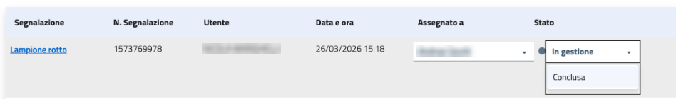
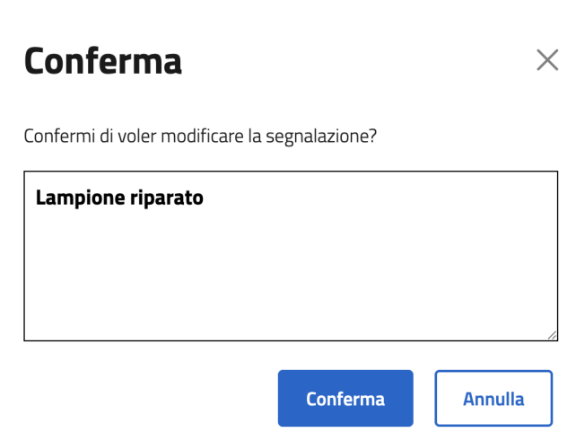
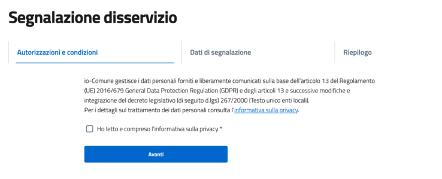
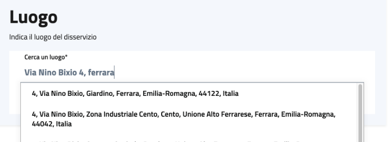
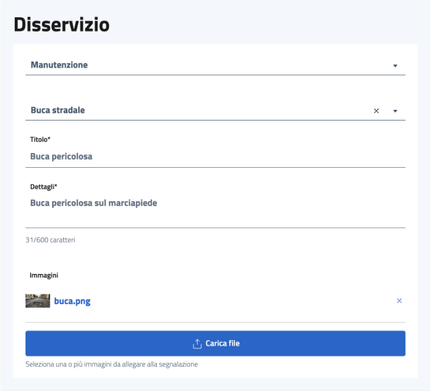
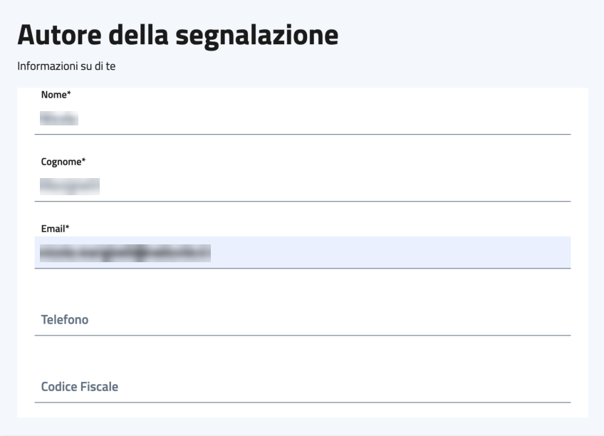

# Manuale Cittadino

Il cittadino interagisce con un'interfaccia guidata, progettata per semplificare l'invio dei dati e garantirne la qualità per gli uffici comunali. Sarà possibile eseguire una segnalazione con autenticazione SPID/CIE, o senza autenticazione con inserimento dati e verifica tramite codice OTP. Nel caso la segnalazione venga eseguita con autenticazione, rimarrà a disposizione come storico nell’area riservata del cittadino.

## Autorizzazioni e Condizioni

Prima di accedere al modulo di inserimento, l'utente deve interagire con la sezione legale. Il cittadino deve quindi obbligatoriamente selezionare la casella di controllo relativa all'informativa sul trattamento dei dati personali impostata dal redattore. Questa operazione risulta obbligatoria, a prescindere che la segnalazione avvenga con autenticazione forte o senza autenticazione.

## Dati di Segnalazione

In questa fase vengono raccolte le informazioni tecniche e geografiche necessarie all'intervento.

### Localizzazione (Luogo)

- Ricerca Indirizzo: Un campo di testo con autocompletamento permette di digitare l'indirizzo esatto del disservizio.
- Georeferenziazione: Il sistema integra mappe digitali per posizionare con precisione la segnalazione.
- Usa la tua posizione: Una funzione rapida permette di rilevare le coordinate GPS correnti direttamente dal dispositivo dell'utente.

### Dettagli del Disservizio

- Tipo di disservizio: Menu a tendina per la selezione della Categoria principale (es. Manutenzione).
- Sottocategoria: Selezione specifica dell'ambito d'intervento (es. Buca stradale o Illuminazione pubblica).
- Titolo: Un campo sintetico per l'oggetto della segnalazione.
- Descrizione (Dettagli): Campo testuale per spiegare il problema. Un contatore dinamico indica i caratteri rimanenti rispetto al limite impostato dall’Ente (es. 600 caratteri).
- Allegati Multimediali: Tramite il pulsante "Carica file", il cittadino può allegare una o più immagini fotografiche per documentare visivamente il danno o il disservizio.

### Autore della Segnalazione

Se non autenticato, il sistema richiede i dati identificativi per la tracciabilità e per l'invio delle notifiche di stato.

- Dati Anagrafici: Nome completo e Codice Fiscale.
- Contatti: Indirizzo email (obbligatorio per ricevere l'OTP) e numero di telefono.

## Validazione e Sicurezza (OTP)

Se non autenticato, per prevenire l'invio di segnalazioni false o prodotte da sistemi automatici (spam), il processo si conclude con una verifica d'identità digitale.

- Invio Codice: Dopo aver cliccato su "Invia", il sistema genera automaticamente un codice OTP (One-Time Password) a 6 cifre e lo invia alla mail del cittadino.
- Verifica: Il cittadino deve inserire il codice ricevuto nel popup di conferma che appare a video (se autenticato con SPID o CIE questo passaggio non sarà necessario).
- Conferma Finale: Solo dopo la validazione del codice, la segnalazione viene registrata nel sistema e inviata agli operatori comunali.

