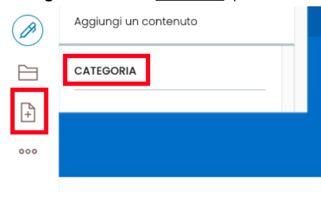
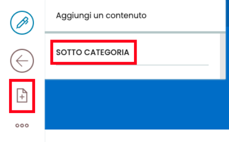
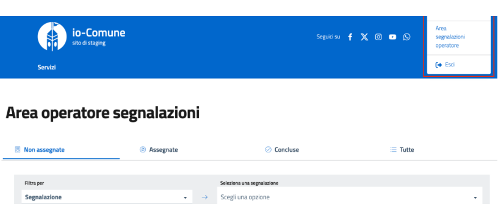
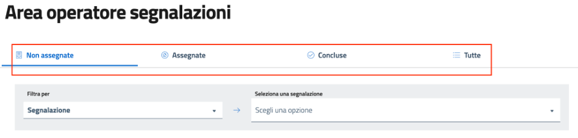
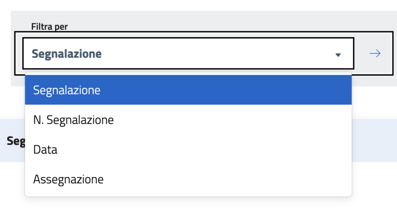
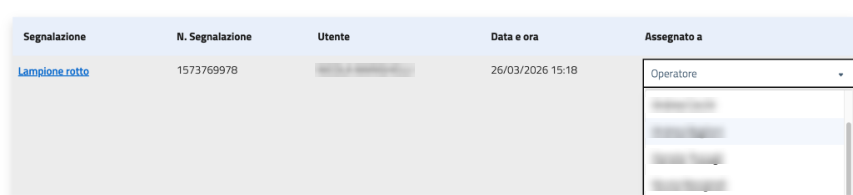
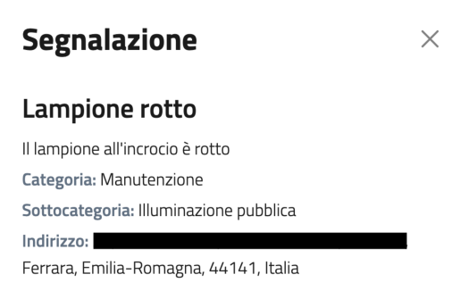

# Manuale Operatore

## Workflow delle segnalazioni

Gli stati del processo sono:

1.  **Non assegnata** : stato predefinito all'invio del cittadino.
2.  **In gestione** : stato attivo quando la pratica viene assegnata a un operatore (genera notifica al cittadino).
3.  **Conclusa** : stato finale post-intervento, con obbligo di nota di chiusura (genera notifica al cittadino).

## Gestione delle segnalazioni pervenute

Per la gestione operativa delle richieste, il prodotto mette a disposizione una specifica area denominata Area operatore segnalazioni.

Attraverso questa sezione è possibile consultare le segnalazioni ricevute, ricercarle tramite filtri, assegnarle ad un operatore, aggiornare lo stato e visualizzarne il dettaglio.

### Viste disponibili

L’area operatore risulta articolata in più viste, che consentono di separare il carico di lavoro in base allo stato della segnalazione:

- Non assegnate
- Assegnate
- Concluse
- Tutte

Questa organizzazione aiuta gli operatori a orientarsi rapidamente all’interno del sistema, distinguendo le segnalazioni ancora da distribuire da quelle già in carico o concluse.

### Filtri di ricerca

Nel pannello operatore è presente una sezione di filtro che consente di individuare rapidamente una segnalazione:

- Segnalazione
- N. Segnalazione
- Data
- Assegnazione

Questi filtri permettono di recuperare una pratica specifica, cercare una segnalazione per numero identificativo, effettuare una consultazione per data o verificare quali elementi risultano assegnati ad un determinato operatore.

### Assegnazione della segnalazione

Le segnalazioni che arrivano nel sistema sono inizialmente marcate con lo status **Non assegnate** . L’operatore può assegnarle selezionando il nominativo desiderato nell’apposito campo **Assegnato a** . Una volta completata l’operazione, la segnalazione viene spostata nella vista Assegnate ed entra nel flusso ordinario di lavorazione, e verrà gestita secondo le logiche e dinamiche interne all’Ente.

### Consultazione del dettaglio

Cliccando sul titolo della segnalazione, l’operatore può visualizzare un riepilogo sintetico dei dati principali, utile per una consultazione rapida. Questa funzionalità consente di verificare con immediatezza il contenuto della richiesta, il luogo associato, la categoria, la sottocategoria e gli altri elementi descrittivi necessari alla lavorazione interna.

### Chiusura della segnalazione

Sempre nel campo di assegnazione, selezionato lo stato Conclusa, il sistema mostra una finestra di conferma con un campo testuale da compilare. Questo testo viene utilizzato come messaggio finale associato alla chiusura della segnalazione e viene riportato nella comunicazione inviata al cittadino tramite notifica.
